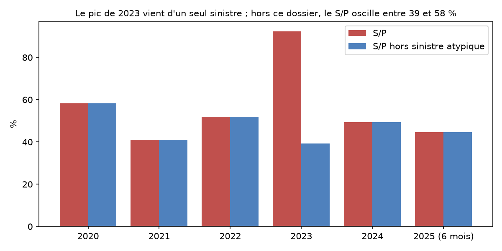
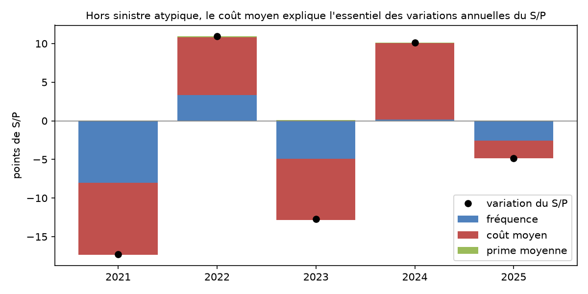
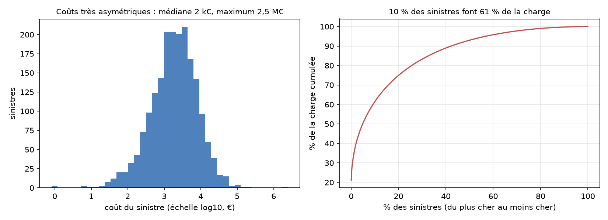

# Livrable 3 · Analyse technique du portefeuille

Le détail des calculs, tableaux, tests et graphiques est dans le notebook [notebooks/L3_analyse_technique.ipynb](../notebooks/L3_analyse_technique.ipynb), exécuté sur l'entrepôt (`make notebooks`). Ce document en reprend les résultats.

## Sources et définitions

**D'où viennent les chiffres :**
- Le notebook lit uniquement les marts dbt :
  - `marts.mart_technique` : mesures additives par année, produit, zone, formule, canal, région et tranche d'âge ;
  - `marts.mart_contrat_annee` : grain contrat × année ;
  - `marts.mart_sinistres` : grain sinistre.
- Un test dbt bloquant (`mart_technique_reconcilie_coeur`) vérifie que les marts restituent les totaux du cœur : primes acquises, années-police, charge et nombre de sinistres.
- Les formules sont codées une seule fois dans `analyse/indicateurs.py`, que le dashboard réutilisera.

| Indicateur | Définition |
|---|---|
| Fréquence | Sinistres avec suite / années-police |
| Coût moyen | Charge (payé + réserve restante) / sinistres avec suite |
| Prime moyenne | Primes acquises / années-police |
| S/P | Charge / primes acquises |
| Taux de résiliation | Résiliations / années-police |

Les sinistres sont rattachés à leur année de survenance. Les sinistres rejetés ou classés sans suite (838, soit 30 % des déclarations) sont comptés à part.

**Ensemble du portefeuille** (2020 à juin 2025) : 45 215 années-police et 20,0 M€ de primes acquises.

| Indicateur | Valeur | IC 95 % |
|---|---|---|
| Fréquence | 4,30 % | 4,11 – 4,50 |
| Coût moyen | 6 020 € | 4 410 – 8 851 |
| Prime moyenne | 442 € | 439 – 446 |
| S/P | 58,5 % | 42,7 – 86,1 |
| S/P hors sinistre atypique | 46,2 % | 41,6 – 51,2 |
| Taux de résiliation | 14,5 % | 14,2 – 14,9 |

## 1. Indicateurs techniques : constats et actions

| Axe | Constat | Action |
|---|---|---|
| Produit | L'habitation a un S/P de 63,8 % (IC 55 – 74), contre 38,0 % (IC 33 – 44) pour l'auto hors sinistre atypique. La fréquence est voisine (4,2 % et 4,4 %). | Commencer la revue tarifaire par l'habitation. |
| Zone | En habitation, la fréquence double de la zone 1 (2,96 %) à la zone 5 (5,77 %), mais la prime n'augmente que de 32 %. Le S/P de la zone 5 atteint 92,5 %. | Relever le tarif habitation des zones 4 et 5. |
| Formule | Auto Essentielle : 396 déclarations sans suite pour 133 sinistres indemnisés. Habitation Essentielle : S/P de 75,5 % et résiliation de 17,1 %. | Revoir la prime de l'Essentielle habitation et expliquer les exclusions de garantie. |
| Canal | La fréquence et la prime ne varient pas selon le canal. La résiliation atteint 18,7 % (auto) et 18,2 % (habitation) sur le Web, contre environ 12 % en agence ou en courtage. | Lancer un plan de fidélisation des souscripteurs Web. |
| Âge | Les 18-25 ans ont la plus forte fréquence auto (7,41 %), mais leur surprime (825 €) maintient leur S/P à 40,8 %. | Ne pas modifier le tarif auto par âge ; surveiller l'habitation des 36-50 ans (S/P de 69,0 %). |
| Garanties | L'Essentielle ne couvre pas la collision, le bris de glace et le vol en auto, ni la tempête en habitation : 474 dossiers rejetés à 100 %. | Rappeler ces exclusions dans les documents et lors de la déclaration. |

**Payé, réserves et sans suite :**
- Les réserves représentent 36,2 % de la charge 2025 et 1,5 % de celle de 2024. Avant 2024, tous les dossiers sont clôturés.
- 2025 doit donc être présentée comme provisoire.

## 2. Décomposition de l'évolution du S/P

**Méthode.** S/P = fréquence × coût moyen / prime moyenne. La variation est décomposée en effets exactement additifs par la méthode LMDI. Le volume d'années-police joue autant sur la charge que sur les primes, donc son effet sur le ratio est nul. Il est chiffré sur la charge.

**Sinistre atypique.** Le sinistre 1129 est une collision auto de 2023 qui a coûté 2,48 M€, soit 22 % de toute la charge. Il est présenté à part.

| Année | S/P | S/P hors atypique | Variation hors atypique (pts) | Effet fréquence | Effet coût moyen | Effet prime moyenne |
|---|---|---|---|---|---|---|
| 2020 | 58,3 % | 58,3 % | | | | |
| 2021 | 41,0 % | 41,0 % | −17,3 | −8,0 | −9,3 | 0,0 |
| 2022 | 52,0 % | 52,0 % | +11,0 | +3,3 | +7,5 | +0,2 |
| 2023 | 92,4 % | 39,3 % | −12,7 | −4,9 | −7,9 | +0,1 |
| 2024 | 49,4 % | 49,4 % | +10,1 | +0,2 | +9,9 | 0,0 |
| 2025 (6 mois) | 44,5 % | 44,5 % | −4,8 | −2,6 | −2,3 | 0,0 |

**Constats :**
1. **Le coût moyen fait le S/P.** Le sinistre 1129 explique à lui seul +47,8 points en 2023 et −43,3 en 2024. Hors ce dossier, l'effet coût moyen est de 7 à 10 points par an, en hausse ou en baisse, de 2021 à 2024.
2. **La fréquence est stable**, entre 4,0 et 4,7 % depuis 2021.
3. **La prime moyenne est figée** (445 € en 2020, 441 € en 2025) : aucune hausse tarifaire n'a compensé l'évolution des coûts.
4. **Le volume a fait croître la charge** de 0,6 à 0,8 M€ par an de 2021 à 2024, sans effet sur le ratio.

**Segments qui contribuent le plus** (produit × zone, hors sinistre atypique) :
- **Dégradations :**
  - auto zone 1 en 2022 (+8,3 points) ;
  - auto zone 3 en 2024 (+3,6) ;
  - habitation zone 5 en 2025 (+8,6), à cause d'un incendie encore ouvert de 110 671 €.
- **Améliorations :** auto zone 1 en 2021 (−12,3) et en 2023 (−7,3).

L'habitation zone 5 est le seul segment à la fois structurellement cher et contributeur récent.

**Années incomplètes :**
- **2020 :** le portefeuille démarre le 01/01/2020, avec une exposition faible (1 857 années-police).
- **2025 :** seuls six mois sont observés, et 36 % de la charge est en réserve.
- **2024 :** quelques dossiers restent ouverts.
- **Sinistres non encore déclarés :** ils n'apparaissent pas au 30/06/2025. Les S/P 2024 et 2025 sont donc des minima.

## 3. Rigueur statistique

**Intervalles de confiance à 95 %.**

| Indicateur | Méthode | Pourquoi |
|---|---|---|
| Fréquence, résiliation | Intervalle exact de Poisson (Garwood) | Événements rapportés à une exposition |
| Coût moyen | Bootstrap percentile sur les sinistres | Coûts très asymétriques |
| S/P, prime moyenne | Bootstrap percentile sur les contrats, 5 000 tirages | Ratio de sommes, avec plusieurs années par contrat |

| Indicateur | Auto | Habitation |
|---|---|---|
| Fréquence | 4,38 % (4,12 – 4,66) | 4,21 % (3,95 – 4,49) |
| Coût moyen | 7 544 € (4 616 – 12 743) | 4 343 € (3 779 – 4 930) |
| Prime moyenne | 589 € (586 – 593) | 287 € (285 – 289) |
| S/P | 56,1 % (34,0 – 95,8) | 63,8 % (55,2 – 73,7) |
| S/P hors atypique | 38,0 % (32,8 – 44,2) | 63,8 % (55,2 – 73,7) |
| Résiliation | 14,7 % (14,2 – 15,2) | 14,4 % (13,9 – 14,9) |

**Tests.**

| Comparaison | Test et justification | Résultat |
|---|---|---|
| Fréquence habitation, zone 5 contre zone 1 | Test E de Poisson (Krishnamoorthy-Thomson) : comptages sur des expositions inégales | 5,77 % contre 2,96 %, rapport 1,95, **p = 1,6·10⁻⁶** : écart significatif |
| Coût d'un sinistre auto, agence contre Web | Mann-Whitney : distributions asymétriques, sans hypothèse de normalité | Moyennes 11 273 € et 4 828 €, mais médianes 2 278 € et 2 382 €, **p = 0,44** : pas de différence. L'écart des moyennes vient d'un seul dossier. |
| Résiliation, Web contre agence (complément) | Test E de Poisson | 18,5 % contre 12,0 %, rapport 1,54, **p < 10⁻¹⁰** |

**Queue de distribution des coûts** (1 945 sinistres avec suite).

| Médiane | 75 % | 90 % | 95 % | 99 % | 99,9 % | Maximum | Moyenne |
|---|---|---|---|---|---|---|---|
| 1 997 € | 5 013 € | 10 829 € | 16 541 € | 43 196 € | 178 188 € | 2 475 975 € | 6 020 € |

**Concentration de la charge :**
- les 2 dossiers les plus chers (0,1 %) font 22,9 % de la charge ;
- les 1 % les plus chers en font 33,4 % ;
- les 5 % les plus chers en font 50,4 % ;
- les 10 % les plus chers en font 61,4 %.

**Coût selon la garantie :** l'incendie est la garantie la plus coûteuse (médiane 9 300 €), devant la RC auto (3 885 €). Le bris de glace est la moins coûteuse (294 €).

**Action :** suivre à part les sinistres de plus de 50 000 € et étudier une réassurance en excédent de sinistre. Un seul dossier a coûté 12 % des primes acquises de toute la période.
