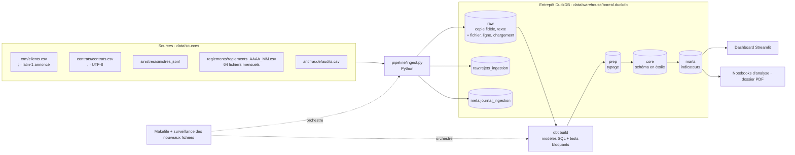

# Livrable 1 · Architecture et ingestion

## 1. Architecture cible



| Couche | Schéma | Contenu | Outil |
|---|---|---|---|
| Brut | `raw` | Copie fidèle de chaque ligne source, toutes valeurs en texte, avec `_fichier_source`, `_numero_ligne`, `_id_chargement`, `_date_chargement`. Lignes illisibles dans `raw.rejets_ingestion`. | Python |
| Journal | `meta` | `journal_ingestion` : une ligne par fichier et par exécution. | Python |
| Préparation | `prep` | Typage (dates, nombres), nettoyage des blancs. Aucune ligne supprimée. | dbt (vues) |
| Cœur | `core` | Schéma en étoile : dimensions et faits au grain explicite, déduplication, quarantaine (livrable 2). | dbt (tables) |
| Marts | `marts` | Tables d'indicateurs prêtes pour le dashboard et les notebooks. | dbt (tables) |

## 2. Justification des outils

Mesures prises sur la machine de développement (Apple M2, 8 Go de RAM) :

| Mesure | Valeur |
|---|---|
| Volume des sources | 2,6 Mo, 68 fichiers, 41 848 lignes de données |
| Taille de l'entrepôt après chargement | 3,0 Mo |
| Pipeline complet depuis un entrepôt vide (`make clean && make run`) | 3,8 s, dont 11 modèles et tests dbt |
| Rechargement d'un mois (`make reload MOIS=2024_03`) | moins de 4 s |
| Environnement Python installé | 431 Mo, 5 dépendances directes |

| Outil | Rôle | Critère mesurable | Alternatives écartées |
|---|---|---|---|
| **DuckDB 1.5** | Entrepôt | *Volumétrie* : 3 Mo d'entrepôt, alors que DuckDB traite des dizaines de Go sur un portable. *Coût* : 0 €, aucun serveur. *Maintenance* : un fichier unique, installé par `pip`. *Compétences* : SQL standard avec fonctions analytiques (`QUALIFY`, fenêtres). | SQLite : pas de type date natif ni de lecture JSON, fonctions d'analyse limitées. PostgreSQL : un serveur à installer et administrer, sans gain à ce volume, et un obstacle pour exécuter le pipeline sur une machine vierge. |
| **Python 3** | Ingestion | Les sources mélangent 2 séparateurs, 2 encodages annoncés, 2 formats (CSV et JSON Lines) et 2 structures d'en-tête au sein des règlements. Une logique de détection, de traçabilité et de journalisation est plus robuste en Python qu'en SQL. | Ingestion 100 % SQL (`read_csv_auto`) : moins de contrôle sur les lignes illisibles et sur le journal. |
| **dbt-core 1.12 + dbt-duckdb** | Transformations et tests | Couvre directement plusieurs critères notés : un test en échec bloque les modèles en aval (`dbt build`), tests d'unicité et d'intégrité inclus, catalogue et lignage générés (`dbt docs`), modèles incrémentaux. 11 nœuds construits et testés en 0,3 s. | Scripts SQL et runner maison : catalogue et lignage à écrire à la main. |
| **Makefile** | Orchestration | 1 point d'entrée, 0 serveur. Toutes les opérations tiennent en une commande (`make run`, `make reload MOIS=…`). | Airflow, Prefect, Dagster : serveur ou compte cloud, une demi-journée à une journée de mise en place pour 68 fichiers et une exécution mensuelle. |
| **Streamlit** (livrable 5) | Dashboard | Lit directement les marts DuckDB, donc mêmes chiffres que l'entrepôt. Gratuit, déjà disponible en Python. | Power BI : indisponible sur macOS. Tableau : licence payante, pas de connecteur DuckDB dans la version gratuite. |

### Avec 100 fois plus de données (environ 260 Mo, 4 millions de lignes)

| Composant | Ce qui changerait |
|---|---|
| Entrepôt | DuckDB tient toujours ce volume sur un poste. Le vrai seuil est ailleurs : DuckDB n'accepte qu'un processus en écriture. Avec plusieurs utilisateurs simultanés ou un dashboard publié, il faudrait passer à PostgreSQL ou à un entrepôt cloud (BigQuery, Snowflake). Les modèles dbt restent quasi identiques : seul l'adaptateur change. |
| Ingestion | Lecture en flux et en parallèle par fichier, avec `read_csv` de DuckDB, plutôt qu'en mémoire via pandas. Couche brute stockée en Parquet partitionné par mois. |
| Transformations | Les tables du cœur passent toutes en incrémental, comme `fct_reglement` aujourd'hui, au lieu d'une reconstruction complète. Les tests portent sur la dernière partition. |
| Orchestration | Avec des dizaines de sources et des dépendances entre elles, un orchestrateur dédié (Dagster ou Airflow) apporte reprises, parallélisme et historique des exécutions. |
| Dashboard | Les marts pré-agrégés suffisent. Il faudrait ajouter un cache et éviter tout calcul ligne à ligne dans l'application. |

## 3. Ingestion des sources (`pipeline/ingest.py`)

Pour chaque fichier correspondant au motif d'une source (`pipeline/config.py`) :

1. **Empreinte** : SHA-256 du contenu, pour reconnaître un fichier déjà chargé.
2. **Encodage** : décodage en UTF-8, sinon en latin-1. L'encodage retenu est noté dans le journal.
3. **Séparateur** : détecté sur l'en-tête (`,` `;` tabulation `|`).
4. **Structure** : les noms de colonnes sont normalisés et comparés au contrat de la source. Les alias connus sont alignés (`montant_eur` → `montant`). Une colonne manquante ou inconnue fait échouer le fichier (`ECHEC`) : rien n'est chargé et le pipeline s'arrête.
5. **Lignes** : chaque ligne valide est copiée telle quelle, en texte, avec son fichier, son numéro de ligne, l'identifiant et la date du chargement. Une ligne vide, avec un mauvais nombre de champs ou un JSON invalide va dans `raw.rejets_ingestion` avec son motif. Rien n'est supprimé sans trace.

### Constats à l'ingestion

| Constat | Mesure | Traitement |
|---|---|---|
| Structure différente au sein des règlements | `reglements_2024_03.csv` : en-tête `montant_eur,paiement_id,sinistre_id,date_paiement` au lieu de `paiement_id,sinistre_id,date_paiement,montant` | Alignement des colonnes par leur nom (alias `montant_eur`), sans intervention manuelle |
| Séparateurs différents | `;` pour les clients, `,` ailleurs | Détection automatique |
| Encodage | `clients.csv` annoncé en latin-1, mais composé uniquement de caractères ASCII. Il est donc lu sans perte quel que soit le décodage. | Décodage UTF-8, repli automatique en latin-1 |
| Paiements livrés deux fois | 3 207 lignes brutes pour 3 175 `paiement_id` distincts : 32 paiements réapparaissent à l'identique (même sinistre, date et montant) dans le fichier du mois suivant | Conservés en brut, dédoublonnés dans `core.fct_reglement` (première livraison conservée, `nb_livraisons` = 2) |
| Fichier postérieur à l'extraction | `reglements_2025_07.csv` existe alors que l'extraction date du 30/06/2025. Il contient 2 paiements datés de juin 2025. | Chargé tel quel. Traité comme règle de qualité au livrable 2. |

Requête de contrôle des doublons :

```sql
SELECT count(*) AS lignes, count(DISTINCT paiement_id) AS paiements FROM raw.reglements;
-- 3207 | 3175
```

## 4. Chargement incrémental et idempotence

### Journal d'ingestion (`meta.journal_ingestion`)

| Colonne | Contenu |
|---|---|
| `id_execution`, `id_chargement` | Exécution du pipeline et chargement du fichier |
| `fichier`, `source`, `sha256` | Fichier traité et empreinte de son contenu |
| `encodage`, `separateur` | Format détecté |
| `lignes_lues`, `lignes_chargees`, `lignes_rejetees` | Volumes (lues = chargées + rejetées) |
| `debut`, `duree_s` | Horodatage et durée |
| `statut`, `message` | `CHARGE`, `RECHARGE`, `IGNORE`, `DOUBLON_LIVRAISON` ou `ECHEC` |

`make journal` affiche la dernière exécution et l'état de chaque source.

### Règles d'idempotence

| Situation | Comportement | Statut |
|---|---|---|
| Fichier déjà chargé, contenu identique | Ignoré | `IGNORE` |
| Fichier connu, contenu modifié (livraison corrigée) | Ses anciennes lignes sont supprimées puis les nouvelles insérées, dans une seule transaction | `RECHARGE` |
| Rechargement demandé (`make reload MOIS=AAAA_MM`) | Même remplacement, forcé | `RECHARGE` |
| Même contenu livré sous un autre nom | Refusé | `DOUBLON_LIVRAISON` |
| Structure non conforme | Rien n'est chargé, code d'erreur, le pipeline s'arrête | `ECHEC` |

Dans le cœur, `core.fct_reglement` applique le principe de l'énoncé (`NOT EXISTS` sur `paiement_id`) sous la forme d'un modèle dbt incrémental `delete+insert` sur `paiement_id`. Seuls les paiements touchés par un chargement récent sont recalculés, à partir de toute la couche brute, avec la même règle de survie. Le résultat est donc identique à celui d'une reconstruction complète.

**Que se passe-t-il au second passage ?**
- **Couche brute :** chaque fichier a la même empreinte, il est donc `IGNORE` et aucune ligne n'est écrite. Le journal garde la trace du passage.
- **Cœur :** aucun paiement n'a de chargement plus récent que le dernier traitement, donc aucune ligne n'est recalculée.
- **Si l'on force le rejeu d'un mois :** les lignes de ce fichier sont remplacées par elles-mêmes et les paiements concernés sont recalculés à l'identique.

**Comment le prouve-t-on ?** Par `tests/test_ingestion.py`, exécuté par `make test` :

| Test | Vérifie |
|---|---|
| `test_relancer_le_pipeline_ne_change_rien` | Second passage complet : 68 `IGNORE`, contenu du brut et du cœur strictement identique (empreinte de chaque ligne) |
| `test_rejouer_un_mois_ne_cree_aucun_doublon` | Rejeu forcé de `2024_03` : même nombre de lignes et même empreinte en brut et en cœur, `paiement_id` unique |
| `test_meme_mois_livre_deux_fois_sous_un_autre_nom_est_refuse` | Copie d'un mois sous un autre nom : `DOUBLON_LIVRAISON`, 0 ligne ajoutée |
| `test_fichier_corrige_remplace_la_version_precedente` | Livraison corrigée : l'ancienne version est entièrement remplacée |
| `test_structure_inconnue_bloque_le_fichier_sans_rien_charger` | Colonne inattendue : `ECHEC`, rien n'est chargé |
| `test_lignes_illisibles_vont_en_rejet_avec_motif` | Lignes vides ou incomplètes : rejetées avec motif, journal cohérent (3 lues = 1 chargée + 2 rejetées) |

Les tests dbt bloquants complètent la preuve : `unique` et `not_null` sur `fct_reglement.paiement_id`, et une réconciliation brut → cœur (même nombre de paiements, même montant total).
