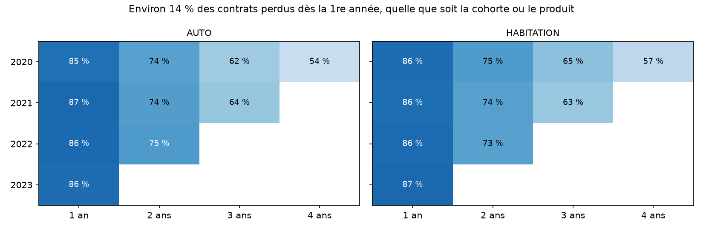
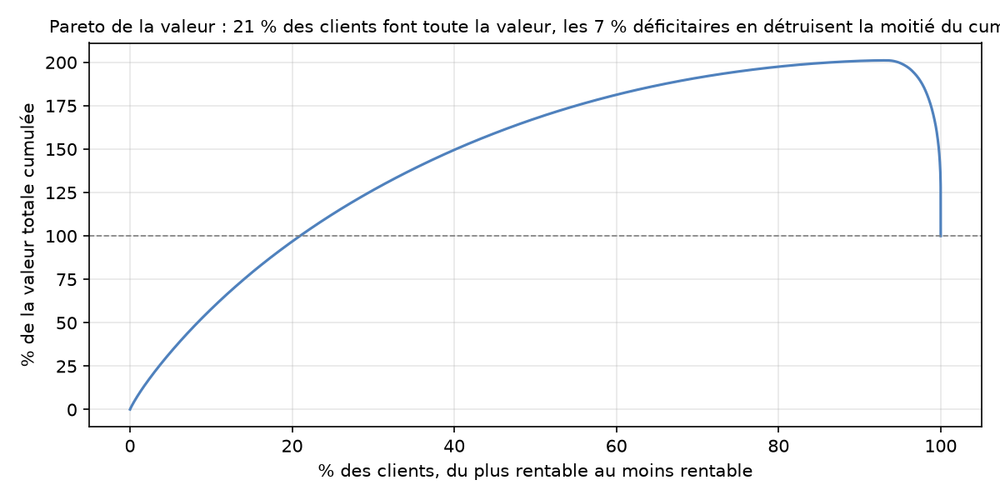
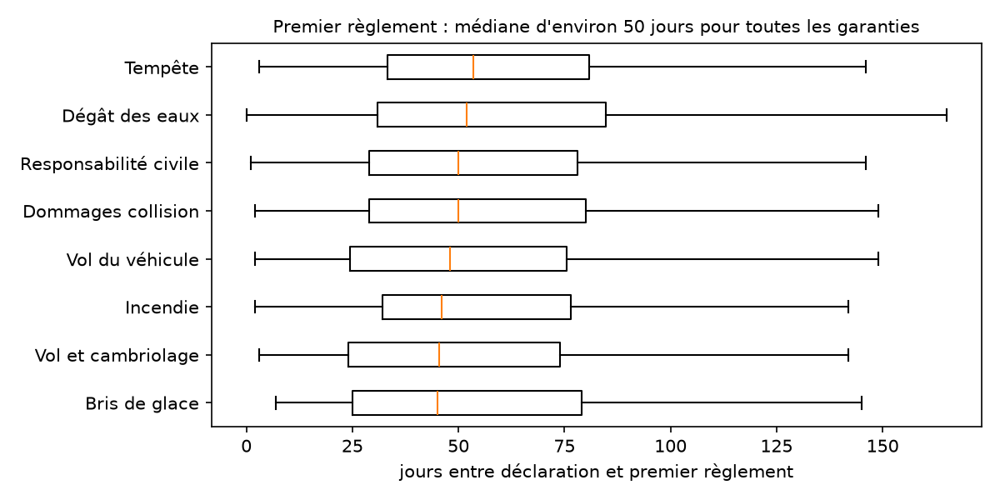

# Livrable 4 · Analyse clients et gestion des sinistres

Le détail des calculs est dans le notebook [notebooks/L4_clients_sinistres.ipynb](../notebooks/L4_clients_sinistres.ipynb), exécuté sur les marts de l'entrepôt :
- `mart_retention_contrats` et `mart_retention_clients` pour les cohortes ;
- `mart_clients` pour la valeur client ;
- `mart_sinistres` pour les délais et les audits.

Un test dbt bloquant (`mart_clients_reconcilie_coeur`) vérifie que la valeur client totale égale les primes acquises moins les sinistres payés du cœur. Chaque chiffre ci-dessous précise sa population.

## 1. Cohortes et multi-détention

**Rétention des contrats par cohorte de souscription.**

Un contrat est retenu à *n* ans s'il n'est pas résilié à son *n*-ième anniversaire. **Population :** contrats valides. Seules les cellules entièrement observables sont présentées, c'est-à-dire celles dont tous les contrats ont atteint l'anniversaire avant le 30/06/2025. Les cohortes 2024 et 2025 n'ont donc encore aucune cellule complète.

| Produit | Cohorte | Contrats | 1 an | 2 ans | 3 ans | 4 ans |
|---|---|---|---|---|---|---|
| Auto | 2020 | 2 061 | 85,2 % | 73,5 % | 62,2 % | 53,9 % |
| Auto | 2021 | 1 928 | 86,8 % | 74,4 % | 63,6 % | |
| Auto | 2022 | 2 004 | 86,5 % | 75,3 % | | |
| Auto | 2023 | 1 905 | 85,8 % | | | |
| Habitation | 2020 | 1 861 | 85,8 % | 75,0 % | 65,0 % | 56,6 % |
| Habitation | 2021 | 1 847 | 85,6 % | 73,7 % | 63,3 % | |
| Habitation | 2022 | 1 935 | 86,4 % | 73,3 % | | |
| Habitation | 2023 | 1 848 | 87,0 % | | | |

La rétention est stable d'une cohorte à l'autre et entre produits. Environ 14 % des contrats sont perdus dès la première année, et aucune cohorte récente ne se dégrade.

**Multi-détention.** 5 242 clients sur 14 977 (35,0 %) ont détenu un contrat auto et un contrat habitation entre 2020 et juin 2025.

**Les multi-détenteurs sont-ils plus fidèles ?** La comparaison directe serait biaisée : un client qui reste longtemps a plus d'occasions de souscrire un second produit. On utilise donc deux mesures qui ne regardent pas le futur.

| Mesure | Population | Résultat |
|---|---|---|
| Rétention à 1 an des contrats selon que le client détenait déjà l'autre produit à la souscription | Contrats des cellules complètes | 87,0 % (n = 2 537) contre 86,0 % (n = 12 852), khi-deux p = 0,21 : **pas de différence** |
| Part des clients actifs au 1ᵉʳ janvier encore clients un an plus tard (2021 à 2024) | Clients actifs à la date de référence | 2 produits : 97,8 à 99,5 % ; 1 produit : 86,8 à 88,3 % |
| Fidélité mécanique attendue pour 2 produits, soit 1 − (1 − p)² avec p la rétention mono-produit | Même population | 98,3 à 98,6 %, identique au taux observé |

**Conclusion.** Le multi-équipement retient le client **par l'addition des contrats** : il faut en résilier deux pour partir. Il ne rend pas chaque contrat plus fidèle. La vente croisée réduit donc la perte de clients, mais elle ne remplace pas une action sur la première échéance.

## 2. Valeur observée des clients

**Définition.** Valeur observée = primes acquises − sinistres payés, du 01/01/2020 au 30/06/2025. Les réserves ouvertes ne sont pas déduites, et les frais de gestion et de distribution ne sont pas connus.

**Population.** 14 977 clients ayant au moins un contrat valide.

**Résultats :**
- **Valeur totale :** 8,82 M€, avec une médiane de 933 € par client.
- **Clients positifs :** ils créent 17,75 M€.
- **Clients déficitaires :** 1 001 clients (6,7 %) détruisent 8,92 M€.

**Concentration** (courbe de Pareto) :

| Clients les plus rentables | 1 % | 5 % | 10 % | 20 % | 50 % |
|---|---|---|---|---|---|
| Part de la valeur totale | 8,3 % | 33,0 % | 57,8 % | 96,8 % | 167,7 % |

**Profils** (déciles de valeur) :

| | 10 % les plus rentables | Ensemble | 10 % les moins rentables |
|---|---|---|---|
| Valeur moyenne | 3 408 € | 589 € | −5 939 € |
| Années-police moyennes | 6,1 | 3,0 | 2,5 |
| Sinistres avec suite par client | 0,08 | 0,13 | 0,78 |
| Multi-détenteurs | 68 % | 35 % | 32 % |
| Encore clients au 30/06/2025 | 95 % | | 55 % |
| Clients « habitation seule » | 0,1 % | 30,6 % | 42,2 % |
| 18-25 ans | 15,1 % | 8,6 % | 9,2 % |

**Ce qui départage :** l'ancienneté, l'absence de sinistre et le multi-équipement.

**Ce qui ne départage pas :** la CSP, la région et l'âge (hors 18-25 ans) ont des répartitions quasi identiques dans les deux groupes.

**Action :** fidéliser et multi-équiper les clients anciens et sans sinistre. Ne pas segmenter le marketing sur la CSP ou la région.

## 3. Délais de gestion des sinistres

**Définitions et populations :**

| Délai | Définition | Population |
|---|---|---|
| Déclaration | Survenance → déclaration | Sinistres valides, hors 15 déclarations antérieures à la survenance |
| Premier règlement | Déclaration → premier paiement | Les 1 845 sinistres payés |
| Clôture | Déclaration → dernier paiement | Sinistres au statut CLOTURE. Les sources n'ont pas de date de clôture : le dernier paiement en tient lieu |

**Résultats par garantie** (médiane, avec le 90ᵉ centile entre parenthèses, en jours) :

| Garantie | Déclaration | Premier règlement | Clôture |
|---|---|---|---|
| Bris de glace | 6 (19) | 45 (106) | 92 (243) |
| Incendie | 6 (23) | 46 (133) | 76 (189) |
| Vol et cambriolage | 6 (25) | 46 (103) | 71 (204) |
| Vol du véhicule | 5 (24) | 48 (113) | 72 (201) |
| Dommages collision | 5 (20) | 50 (118) | 80 (209) |
| Responsabilité civile | 5 (18) | 50 (109) | 88 (201) |
| Dégât des eaux | 5 (19) | 52 (117) | 88 (223) |
| Tempête | 4 (17) | 54 (139) | 84 (221) |

**Part des dossiers payés réglés sous un délai donné :**

| ≤ 30 j | ≤ 60 j | ≤ 90 j | ≤ 180 j |
|---|---|---|---|
| 27,1 % | 61,5 % | 81,0 % | 98,3 % |

**Lecture.**
- Les assurés déclarent vite.
- Le premier règlement prend environ 50 jours quelle que soit la garantie. Le délai dépend donc du processus de gestion plutôt que de la complexité du dossier.

**Action :** les sources ne contiennent aucun engagement de délai. Fixer un objectif de premier règlement, par exemple 60 jours, aujourd'hui atteint pour 61,5 % des dossiers, et le suivre dans le dashboard.

## 4. Audits antifraude

**Population.** Les audits ne portent que sur les dossiers contrôlés : 370 audits valides sur 2 783 sinistres (13,3 %). 37 fraudes ont été confirmées, soit un taux de confirmation de **10,0 % (IC 95 % 7,1 – 13,5) parmi les dossiers audités**. Ce taux ne vaut pas pour le portefeuille : les dossiers ont été choisis, pas tirés au hasard.

**Taux de confirmation selon les critères disponibles** (population : dossiers audités) :

| Critère | Part auditée | Fraude confirmée parmi les audités |
|---|---|---|
| Réserve > 10 k€ | 57,7 % | 5,5 % |
| Réserve nulle | 2,4 % | 20,0 % |
| Déclaration > 30 jours après la survenance | 46,0 % | **55,2 %** (32 sur 58) |
| Déclaration ≤ 7 jours | 11,4 % | 0,0 % (0 sur 200) |
| Sinistre < 90 jours après la souscription | 16,6 % | **20,8 %** |
| Sinistre ≥ 90 jours après la souscription | 12,9 % | 8,2 % |
| Bris de glace | 3,9 % | 30,8 % |
| Vol du véhicule | 11,4 % | 26,3 % |
| Responsabilité civile | 23,6 % | 1,9 % |
| Incendie | 45,4 % | 8,2 % |

**Tests exacts de Fisher**, sur les dossiers audités :
- déclaration tardive : rapport de cotes 75,6, p = 4,5·10⁻²⁵ ;
- contrat de moins de 90 jours : rapport de cotes 2,9, p = 0,011.

**Lecture.** La sélection actuelle vise les gros montants et l'incendie ou la RC, où la fraude se confirme peu. La fraude se concentre ailleurs : sur les déclarations tardives, les contrats récents, le vol et le bris de glace.

**Intérêt au regard des montants :**

| | Dossiers | Charge | Payé | Payé avant l'audit | Payé après l'audit |
|---|---|---|---|---|---|
| Tous les audits | 370 | 6 520 414 € | 6 415 578 € | 3 964 618 € | 2 450 960 € |
| Fraudes confirmées | 37 | 506 127 € | 487 280 € | 80 703 € | **406 577 €** |

**Constats :**
- Les fraudes confirmées ont été payées pour l'essentiel **après** la date d'audit, et 30 d'entre elles sont au statut « clôturé » et non « rejeté ».
- Les audits interviennent 53 jours en médiane après la déclaration, soit après le premier règlement (environ 50 jours).
- 68 déclarations tardives restent non auditées, pour une charge de 126 684 €.

**Actions :**
1. Suspendre les paiements dès qu'une fraude est confirmée, et engager le recouvrement des 406 577 € versés après confirmation.
2. Réorienter la sélection des audits vers les déclarations tardives et les sinistres survenus dans les 90 jours suivant la souscription.
3. Auditer avant le premier règlement.

*Limite : les sources ne disent pas si un recouvrement a eu lieu en dehors de ces données.*
