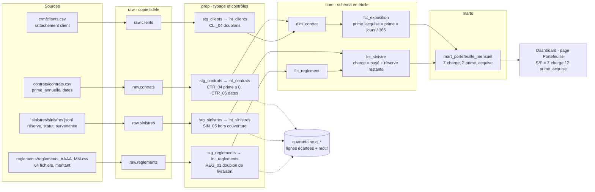

# Lignage d'un indicateur : le ratio S/P, de la source au graphique

Exemple suivi : le **S/P annuel** affiché sur la page Portefeuille du dashboard et dans le dossier (livrable 3). Le lignage complet et interactif de toutes les tables est consultable avec `make docs`, puis `dbt docs serve`.

| Étape | Objet | Transformation | Contrôle |
|---|---|---|---|
| 1 | `contrats.csv`, `sinistres.jsonl`, `reglements_*.csv`, `clients.csv` | Lecture, détection de l'encodage, du séparateur et des en-têtes (`pipeline/ingest.py`) | Journal d'ingestion, rejets de lecture, empreinte SHA-256 |
| 2 | `raw.*` | Copie fidèle en texte, avec fichier, ligne et chargement | `ingestion_sans_echec` |
| 3 | `prep.stg_*` | Typage des dates et des montants | Colonnes illisibles repérées |
| 4 | `prep.int_*` | 36 règles de qualité ; dédoublonnage des clients et des paiements | Quarantaine avec motif, `reconciliation_*` |
| 5 | `core.fct_exposition` | Prime acquise = prime annuelle × jours couverts / 365, par contrat et par année | `exposition_toujours_positive`, `exposition_egale_duree_contrat` |
| 6 | `core.fct_reglement`, `core.fct_sinistre` | Charge = règlements payés + réserve restante des dossiers ouverts | `montant_paye_egal_reglements`, `reconciliation_reglements_brut_coeur` |
| 7 | `marts.mart_portefeuille_mensuel` | Sommes par mois, produit, zone, canal et région | `mart_technique_reconcilie_coeur` (mêmes totaux que le cœur) |
| 8 | Dashboard (`dashboard/app.py`) et notebooks | S/P = Σ charge / Σ primes acquises (`analyse/indicateurs.py`, définition unique) | `tests/test_dashboard.py` |
