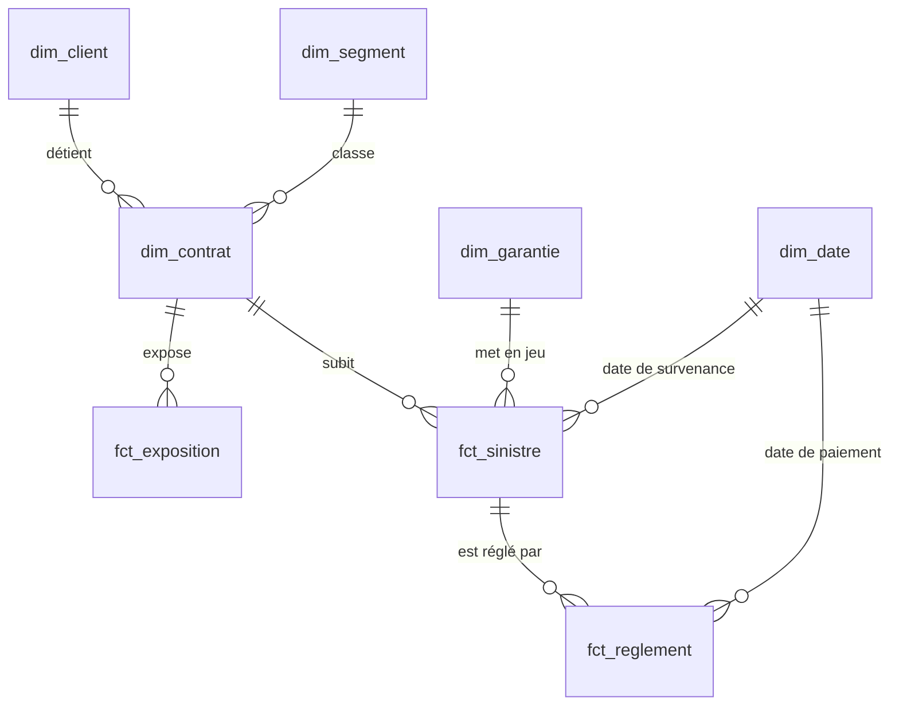

# Livrable 2 · Qualité des données et modélisation

Tous les chiffres de ce document sont produits par l'entrepôt (`make run`). La table `qualite.bilan_regles` les recalcule à chaque exécution.

## 1. Contrôles et quarantaine

### Principe

Les contrôles sont écrits dans les modèles `prep.int_<source>` (dossier `dbt/models/intermediate/`). Chaque ligne y reçoit la liste des règles qu'elle viole (colonne `anomalies`). Le traitement de chaque règle est défini une seule fois, dans le catalogue `dbt/seeds/regles_qualite.csv` :

| Traitement | Effet |
|---|---|
| **EXCLURE** | La ligne ne va pas dans le cœur. Elle est copiée dans `quarantaine.q_<source>` avec son fichier, son numéro de ligne et le libellé des règles violées (`motif`). |
| **CORRIGER** | La ligne va dans le cœur avec une valeur corrigée, et la règle reste visible dans `anomalies_signalees`. |
| **SIGNALER** | La ligne va dans le cœur sans modification, et la règle reste visible dans `anomalies_signalees`. |

Aucune ligne n'est supprimée. Pour chaque source, lignes brutes = lignes du cœur + lignes en quarantaine. Un test bloquant le vérifie (§ 4).

Les exclusions se propagent d'une table à l'autre :
- un contrat en quarantaine écarte ses sinistres (SIN_04) ;
- un sinistre en quarantaine écarte ses paiements (REG_04) et son audit (AUD_03).

Le périmètre reste ainsi cohérent : aucun paiement n'est rattaché à un contrat absent du cœur.

### Les 36 règles

La gravité exprime l'effet du défaut sur les indicateurs :
- **CRITIQUE** : la ligne est inexploitable (identifiant absent, référence cassée).
- **MAJEURE** : la ligne fausserait un indicateur (prime négative, doublon).
- **MINEURE** : la ligne reste exploitable, avec une réserve.

Les règles à volume nul restent actives : elles protègent les prochaines livraisons mensuelles.

| Règle | Dimension | Description | Condition SQL (modèle) | Gravité | Volume | Traitement |
|---|---|---|---|---|---|---|
| AUD_01 | unicité | Sinistre audité plusieurs fois | `a.rang_id > 1` (int_audits.sql) | MAJEURE | 0 (0,0 %) | EXCLURE |
| AUD_02 | complétude | Champ absent, illisible ou hors référentiel (sinistre, date, résultat 0/1) | `a.sinistre_id is null or a.date_audit is null or a.fraude_confirmee not in (0, 1) or a.fraude_confirmee is null or len(a.colonnes_illisibles) > 0` (int_audits.sql) | CRITIQUE | 0 (0,0 %) | EXCLURE |
| AUD_03 | cohérence entre tables | Sinistre audité inconnu ou en quarantaine | `s.sinistre_id is null or s.est_exclu` (int_audits.sql) | MAJEURE | 2 (0,54 %) | EXCLURE |
| AUD_04 | cohérence temporelle | Audit antérieur à la déclaration du sinistre | `a.date_audit < s.date_declaration` (int_audits.sql) | MINEURE | 0 (0,0 %) | SIGNALER |
| CLI_01 | complétude | Date de naissance absente | `date_naissance is null and not list_contains(colonnes_illisibles, 'date_naissance')` (int_clients.sql) | MINEURE | 226 (1,49 %) | SIGNALER |
| CLI_02 | validité | Date de naissance sentinelle 1890-01-01 (âge supérieur à 120 ans) | `date_naissance < date '2025-06-30' - interval 120 year` (int_clients.sql) | MINEURE | 18 (0,12 %) | CORRIGER |
| CLI_03 | validité | Date de naissance impossible : client encore mineur à la date d'extraction | `date_naissance + interval 18 year > date '2025-06-30'` (int_clients.sql) | MAJEURE | 22 (0,14 %) | CORRIGER |
| CLI_04 | unicité | Doublon de client (même empreinte d'e-mail qu'un client conservé) | `client_id_retenu <> client_id` (int_clients.sql) | MAJEURE | 200 (1,32 %) | EXCLURE |
| CLI_05 | unicité | Identifiant client présent plusieurs fois | `rang_id > 1` (int_clients.sql) | CRITIQUE | 0 (0,0 %) | EXCLURE |
| CLI_06 | validité | Valeur illisible ou hors référentiel (identifiant, date, région, CSP, consentement) | `client_id is null or email_hash is null or len(colonnes_illisibles) > 0 or region not in ('ARA','BFC','BRE','COR','CVL','GES','HDF','IDF','NAQ','NOR','OCC','PACA','PDL') or csp not in ('AGRICULTEUR','CADRE','EMPLOYE','ETUDIANT','INDEPENDANT','OUVRIER','RETRAITE','SANS_ACTIVITE') or consent_marketing not in (0, 1)` (int_clients.sql) | MAJEURE | 0 (0,0 %) | EXCLURE |
| CLI_07 | cohérence temporelle | Client mineur à la date de sa première souscription | `date_naissance + interval 18 year > date_premiere_souscription and date_naissance + interval 18 year <= date '2025-06-30'` (int_clients.sql) | MINEURE | 700 (4,61 %) | SIGNALER |
| CTR_01 | unicité | Identifiant contrat présent plusieurs fois | `rang_id > 1` (int_contrats.sql) | CRITIQUE | 0 (0,0 %) | EXCLURE |
| CTR_02 | complétude | Champ obligatoire absent, illisible ou hors référentiel (client, produit, dates, formule, canal, zone, franchise, prime) | `contrat_id is null or client_id is null or date_effet is null or prime_annuelle is null or franchise is null or len(colonnes_illisibles) > 0 or produit not in ('AUTO', 'HABITATION') or formule not in ('ESSENTIELLE', 'CONFORT', 'PREMIUM') or canal_distribution not in ('AGENT', 'COURTIER', 'WEB') or zone_risque not between 1 and 5` (int_contrats.sql) | CRITIQUE | 0 (0,0 %) | EXCLURE |
| CTR_03 | cohérence entre tables | Client du contrat inconnu du CRM ou en quarantaine | `client_id_retenu is null or client_retenu_exclu` (int_contrats.sql) | CRITIQUE | 0 (0,0 %) | EXCLURE |
| CTR_04 | validité | Prime annuelle nulle ou négative | `prime_annuelle <= 0` (int_contrats.sql) | MAJEURE | 25 (0,12 %) | EXCLURE |
| CTR_05 | cohérence temporelle | Date de résiliation antérieure à la date d'effet | `date_resiliation < date_effet` (int_contrats.sql) | MAJEURE | 20 (0,1 %) | EXCLURE |
| CTR_06 | cohérence temporelle | Contrat résilié le jour de son effet (couverture d'un jour) | `date_resiliation = date_effet` (int_contrats.sql) | MINEURE | 6 (0,03 %) | SIGNALER |
| CTR_07 | validité | Attribut incohérent avec le produit (auto sans puissance ou bonus-malus / habitation sans surface) | `(produit = 'AUTO' and (puissance_cv is null or bonus_malus is null)) or (produit = 'HABITATION' and surface_m2 is null)` (int_contrats.sql) | MINEURE | 0 (0,0 %) | SIGNALER |
| CTR_08 | cohérence temporelle | Date d'effet postérieure à la date d'extraction | `date_effet > date '2025-06-30'` (int_contrats.sql) | MAJEURE | 0 (0,0 %) | EXCLURE |
| REG_01 | unicité | Paiement déjà livré dans un fichier antérieur (copie écartée) | `paiement_id is not null and rang_livraison > 1` (int_reglements.sql) | MAJEURE | 32 (1,0 %) | EXCLURE |
| REG_02 | complétude | Champ obligatoire absent ou illisible (paiement, sinistre, date, montant) | `paiement_id is null or sinistre_id is null or date_paiement is null or montant is null or len(colonnes_illisibles) > 0` (int_reglements.sql) | CRITIQUE | 0 (0,0 %) | EXCLURE |
| REG_03 | cohérence entre tables | Sinistre du paiement inconnu | `sinistre_id is not null and not sinistre_connu` (int_reglements.sql) | CRITIQUE | 0 (0,0 %) | EXCLURE |
| REG_04 | cohérence entre tables | Sinistre du paiement en quarantaine | `sinistre_connu and sinistre_exclu` (int_reglements.sql) | MAJEURE | 24 (0,75 %) | EXCLURE |
| REG_05 | validité | Montant nul ou négatif | `montant <= 0` (int_reglements.sql) | MAJEURE | 0 (0,0 %) | EXCLURE |
| REG_06 | cohérence temporelle | Paiement antérieur à la survenance ou postérieur à l'extraction | `date_paiement < sinistre_date_survenance or date_paiement > date '2025-06-30'` (int_reglements.sql) | MAJEURE | 0 (0,0 %) | EXCLURE |
| REG_07 | cohérence temporelle | Ligne livrée dans un fichier postérieur à la date d'extraction | `mois_livraison > strftime(date '2025-06-30', '%Y_%m')` (int_reglements.sql) | MINEURE | 2 (0,06 %) | SIGNALER |
| REG_08 | cohérence | Paiement sur un sinistre rejeté ou sans suite | `sinistre_statut in ('REJETE', 'SANS_SUITE')` (int_reglements.sql) | MAJEURE | 0 (0,0 %) | SIGNALER |
| SIN_01 | unicité | Identifiant sinistre présent plusieurs fois | `rang_id > 1` (int_sinistres.sql) | CRITIQUE | 0 (0,0 %) | EXCLURE |
| SIN_02 | complétude | Champ obligatoire absent, illisible ou hors référentiel (contrat, dates, garantie, statut, réserve) | `sinistre_id is null or contrat_id is null or date_survenance is null or date_declaration is null or reserve_initiale is null or len(colonnes_illisibles) > 0 or statut not in ('OUVERT', 'CLOTURE', 'REJETE', 'SANS_SUITE')` (int_sinistres.sql) | CRITIQUE | 0 (0,0 %) | EXCLURE |
| SIN_03 | cohérence entre tables | Contrat du sinistre inconnu | `not contrat_connu` (int_sinistres.sql) | CRITIQUE | 0 (0,0 %) | EXCLURE |
| SIN_04 | cohérence entre tables | Contrat du sinistre en quarantaine | `contrat_connu and contrat_exclu` (int_sinistres.sql) | MAJEURE | 5 (0,18 %) | EXCLURE |
| SIN_05 | cohérence temporelle | Survenance hors de la période de couverture du contrat | `date_survenance < contrat_date_effet or date_survenance > coalesce(contrat_date_resiliation, date '2025-06-30') or date_survenance > date '2025-06-30'` (int_sinistres.sql) | MAJEURE | 18 (0,64 %) | EXCLURE |
| SIN_06 | cohérence temporelle | Déclaration antérieure à la survenance | `date_declaration < date_survenance` (int_sinistres.sql) | MINEURE | 15 (0,53 %) | CORRIGER |
| SIN_07 | cohérence entre tables | Garantie incompatible avec le produit du contrat | `contrat_connu and not garantie_compatible` (int_sinistres.sql) | MAJEURE | 0 (0,0 %) | EXCLURE |
| SIN_08 | validité | Réserve initiale atypique (supérieure à 1 million d'euros) | `reserve_initiale > 1000000` (int_sinistres.sql) | MINEURE | 1 (0,04 %) | SIGNALER |
| SIN_09 | cohérence | Sinistre rejeté ou sans suite avec une réserve positive | `statut in ('REJETE', 'SANS_SUITE') and reserve_initiale > 0` (int_sinistres.sql) | MINEURE | 0 (0,0 %) | SIGNALER |

### Impact des exclusions

| Source | Lignes brutes | En quarantaine | Montant écarté | Motif principal |
|---|---|---|---|---|
| Clients | 15 200 | 200 (1,32 %) | aucun | Doublons (CLI_04), sans contrat |
| Contrats | 20 264 | 45 (0,22 %) | 7 562,83 € de primes annuelles | 25 primes nulles ou négatives (−50 € ou 0 €), 20 résiliations avant l'effet |
| Sinistres | 2 805 | 22 (0,78 %) | 52 503,15 € de réserves initiales | 18 survenances hors couverture, 4 sur un contrat écarté |
| Règlements | 3 207 | 56 (1,75 %) | 118 175,46 € | 32 copies de livraison (73 150,42 €), 24 paiements de sinistres écartés (45 025,04 €) |
| Audits | 372 | 2 (0,54 %) | aucun | Audits de sinistres écartés |

**Ce qu'il faut retenir :**
- Sans le dédoublonnage des règlements, les montants payés seraient surestimés de 73 150,42 €, soit 0,65 % du total payé.
- Les exclusions de contrats et de sinistres pèsent moins de 0,8 % des volumes.

**Point d'attention pour l'analyse : le sinistre 1129.** C'est une collision auto de 2023. Sa réserve initiale est de 1 252 690,25 € et il a donné lieu à 2 475 974,67 € de règlements, soit **22 % de tous les montants payés** de 2020 à juin 2025.
- Ce n'est pas une erreur de saisie démontrable : la réserve et les paiements sont cohérents entre eux.
- Il est donc conservé et signalé (SIN_08, colonne `est_atypique`).
- Les analyses du livrable 3 présenteront le ratio sinistres sur primes avec et sans ce sinistre grave.

**Défaut de la source non corrigé : âges au CRM.** 700 clients auraient été mineurs (13 à 17 ans) à leur première souscription (CLI_07). Les dates de naissance s'accumulent juste avant le 30/06/2007, et 491 clients ont exactement 18 ans à la date d'extraction. Tout indique des âges plafonnés à 18 ans à la date d'extraction. La date n'est pas corrigée, mais la tranche d'âge est calculée à la date d'extraction pour ne créer aucun client mineur dans les analyses.

## 2. Déduplication des clients

**Clé de rapprochement : l'empreinte d'e-mail (`email_hash`).** C'est le seul identifiant personnel disponible : les données sont pseudonymisées, sans nom ni coordonnées.

**Mesure :**
- 200 empreintes apparaissent deux fois, soit 400 fiches.
- Le taux de doublons est de **200 / 15 200 = 1,32 %** des fiches.

**Contrôle de la clé :** pour les 200 paires, la date de naissance, la région, la CSP et le consentement sont identiques. La clé ne rapproche donc pas de personnes différentes.

```sql
SELECT count(*) AS paires,
       count(*) FILTER (WHERE n_dn = 1 AND n_region = 1 AND n_csp = 1 AND n_consent = 1) AS attributs_identiques
FROM (SELECT email_hash, count(DISTINCT date_naissance) n_dn, count(DISTINCT region) n_region,
             count(DISTINCT csp) n_csp, count(DISTINCT consent_marketing) n_consent
      FROM prep.stg_clients GROUP BY email_hash HAVING count(*) > 1);
-- 200 | 200
```

**Règle de survie :** parmi les fiches de même empreinte, on conserve celle qui porte des contrats, puis le plus petit identifiant.
- Ici, la fiche conservée est toujours l'identifiant ancien (33 à 14 988).
- Les doublons (identifiants 15 001 à 15 200) n'ont aucun contrat.

**Contrats rattachés :** la table `core.client_rapprochement` fait passer chaque identifiant du CRM vers l'identifiant conservé. Tout contrat est rattaché au survivant (`dim_contrat.client_id` = `client_id_retenu`). Dans cette livraison, aucun contrat ne portait un identifiant doublon. Si cela arrive dans une livraison future, le contrat est rattaché automatiquement sans être perdu.

**Fiches écartées :** les 200 fiches doublons vont dans `quarantaine.q_clients` avec le motif CLI_04.

## 3. Modèle dimensionnel



### Grains

| Table | Grain | Lignes | Mesures principales |
|---|---|---|---|
| `fct_exposition` | un contrat × une année civile | 65 109 | `jours_couverts`, `annees_police`, `prime_acquise`, `resilie_dans_annee` |
| `fct_sinistre` | un sinistre | 2 783 | `reserve_initiale`, `montant_paye`, `reserve_restante`, `charge_totale`, délais, audit |
| `fct_reglement` | un paiement | 3 151 | `montant` |
| `dim_contrat` | un contrat | 20 219 | attributs de souscription, `date_fin_observation` |
| `dim_client` | un client conservé | 15 000 | âge, région, CSP, consentement |
| `dim_segment` | produit × zone × formule × canal | 90 | |
| `dim_garantie` | produit × garantie | 8 | |
| `dim_date` | un jour (2019 à 2025) | 2 557 | |

**Pourquoi l'exposition au grain contrat × année ?** L'énoncé impose une fréquence par année-police. Ce grain permet de calculer directement :
- la fréquence d'une année : sinistres survenus dans l'année / somme des `annees_police` de l'année ;
- les primes acquises de l'année, au prorata des jours couverts ;
- le taux de résiliation par année.

**Règles de calcul de l'exposition :**
- Couverture du jour d'effet au jour de résiliation, bornes incluses.
- Pour les contrats en cours, la couverture est arrêtée au 30/06/2025.
- Années-police = jours couverts / 365. Prime acquise = prime annuelle × jours couverts / 365.
- 2025 n'est observée que sur six mois (`annee_complete = false`).

```sql
-- Exposition et primes acquises par année
SELECT annee, round(sum(annees_police), 1) AS annees_police, round(sum(prime_acquise)) AS primes_acquises
FROM core.fct_exposition GROUP BY annee ORDER BY annee;
-- 2020 : 1 857,2 | 2021 : 5 154,6 | 2022 : 8 075,9 | 2023 : 10 555,2 | 2024 : 12 681,8 | 2025 (6 mois) : 6 890,4
```

**Ce que contiennent les faits sinistre :**
- *payé* : les règlements reçus (`montant_paye`) ;
- *réserve* : la réserve restante des dossiers ouverts (`reserve_restante`) ;
- *sans suite* : les dossiers rejetés ou classés (`est_sans_suite`).

Les sources ne contiennent pas de date de clôture. Pour un dossier clôturé, la date du dernier règlement en tient lieu (`delai_cloture_j`).

### Gestion de l'historique

| Dimension | Type | Justification |
|---|---|---|
| `dim_client` | Type 1 dans le cœur, type 2 dans `snapshots.snap_clients` | Le CRM ne livre qu'un instantané : aucun historique n'existe dans les sources. Le snapshot dbt (stratégie `check` sur région, CSP, consentement, date de naissance) enregistre une nouvelle version à chaque changement lors des livraisons mensuelles suivantes, avec ses dates de validité. Les analyses utilisent la valeur courante. |
| `dim_contrat` | Type 0 | Les attributs (formule, zone, prime, franchise) sont ceux de la souscription. Une modification de contrat serait un nouvel avenant, absent des sources. |
| `dim_segment`, `dim_garantie` | Type 0 | Ce sont des référentiels. |

## 4. Tests automatisés

**Comment ils s'exécutent :**
- `make run` lance `dbt build`, qui exécute chaque test juste après le modèle testé. Un test en échec interrompt la construction des modèles qui en dépendent.
- `make test` relance en plus les tests pytest du livrable 1.

**État actuel (version livrée) :** 94 éléments dbt, dont 56 tests (les marts des livrables 3 à 5 en ajoutent 8), et 17 tests pytest, tous au vert.

| Test | Type | Vérifie |
|---|---|---|
| `unique` + `not_null` sur les clés de `dim_client`, `dim_contrat`, `dim_segment`, `dim_garantie`, `dim_date`, `fct_exposition`, `fct_sinistre`, `fct_reglement`, `client_rapprochement` | générique | Unicité des clés |
| `relationships` : contrat → client et segment, exposition → contrat, sinistre → contrat et garantie, règlement → sinistre et date, rapprochement → client | générique | Intégrité référentielle du schéma en étoile |
| `accepted_values` sur produit, statut, tranche d'âge, traitement | générique | Validité des référentiels |
| `unique` sur `dim_client.email_hash` | générique | Aucun doublon client résiduel |
| `reconciliation_reglements_brut_coeur` | singulier | Lignes et montant des règlements : brut = cœur + quarantaine, au centime |
| `reconciliation_sources_coeur_quarantaine` | singulier | Pour clients, contrats, sinistres et audits : brut = cœur + quarantaine |
| `exposition_toujours_positive` | singulier | Chaque ligne d'exposition couvre entre 1 et 366 jours, avec une prime acquise positive |
| `exposition_egale_duree_contrat` | singulier | La somme des expositions annuelles d'un contrat égale sa durée de couverture |
| `sinistre_dans_periode_couverture` | singulier | Tout sinistre du cœur survient pendant la couverture de son contrat |
| `montant_paye_egal_reglements` | singulier | Le payé d'un sinistre égale la somme de ses règlements |
| `quarantaine_avec_motif` | singulier | Toute ligne écartée a un motif et un fichier d'origine |
| `ingestion_sans_echec` | singulier | Aucun fichier source n'est en échec dans le journal |
| `tests/test_ingestion.py` (6 tests) | pytest | Idempotence et rechargement (livrable 1) |
